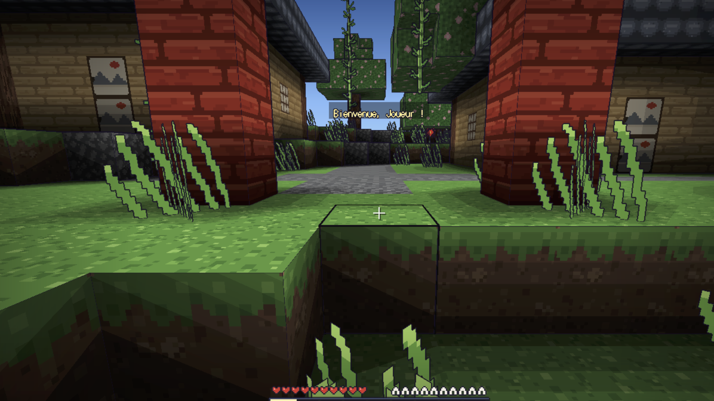
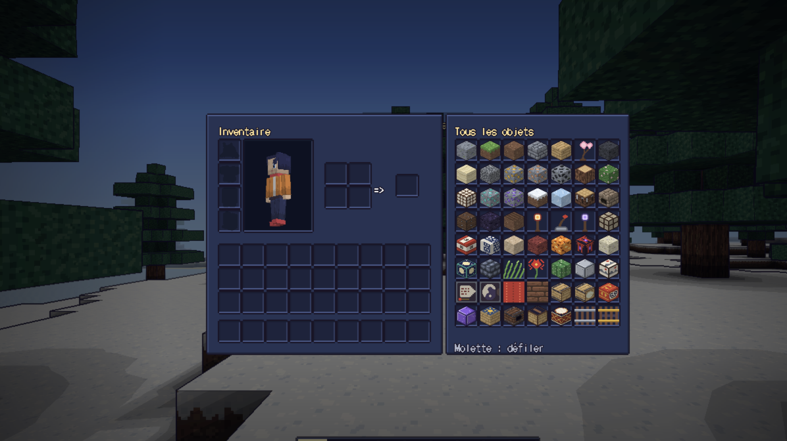
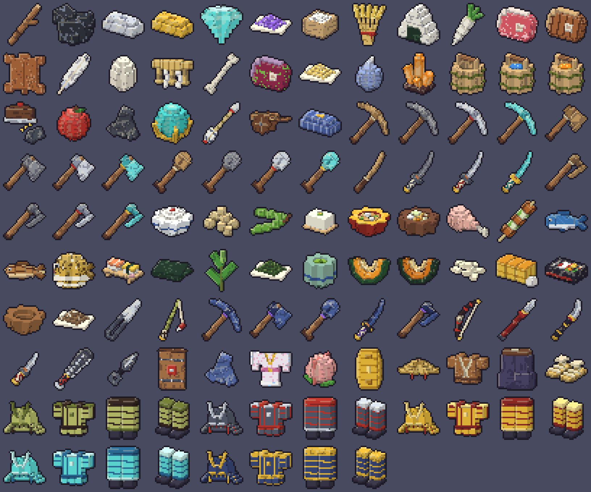

# Epicube Craft

Un jeu de survie en blocs, écrit en Rust, dans un Japon de légende : villages aux toits de tuiles, sanctuaires, yōkai, katanas et circuits de reiseki. On y retrouve les grandes mécaniques du genre (récolter, fabriquer, cultiver, explorer, construire des machines), dans un style pixel art inspiré du manga.



Le jeu tourne sur **macOS, Linux et Windows**, en solo ou à plusieurs, avec un serveur qui fait autorité sur le monde.

> Epicube Craft est un projet indépendant. Il n'est ni affilié à Mojang ou Microsoft, ni approuvé par eux, et ne contient aucun élément de Minecraft : code, textures, modèles et sons sont originaux ou sous licence libre.

## Ce qu'on y trouve

- **Un monde immense** : 60 millions de blocs de côté, 384 de haut, dix biomes à la surface, grottes, ravins, mines abandonnées et géodes, le tout tiré d'une graine.
- **Trois mondes** : la surface, Yomi (le pays des morts) et Takamagahara (la plaine céleste), où attend le dragon Ryūjin.
- **Des structures** : villages et leurs habitants qui commercent en koban, sanctuaires, tombes kofun piégées, temples moussus.
- **Survie** : vie, faim, souffle, armures en six matières, outils en cinq, armes japonaises (yumi, yari, naginata, tantō, tetsubō, kunai, bouclier tate).
- **Ferme et cuisine** : riz, soja, thé, daikon, kabocha, élevage, pêche, et une vingtaine de plats, de l'onigiri au bento.
- **Circuits de reiseki** : fils, relais, comparateurs, pistons, observateurs, distributeurs, entonnoirs, rails et chariots.
- **Modes de jeu** : survie, créatif, aventure, spectateur, extrême ; quatre difficultés.
- **Multijoueur** : chat, commandes avec suggestions, chat vocal de proximité.
- **Ressources modifiables** : textures en PNG, modèles au format Blockbench, sons remplaçables.



## Jouer

Téléchargez l'archive de votre système depuis la page des [versions](../../releases/latest), décompressez-la et lancez `epicube-craft`. Le dossier `audio` doit rester à côté de l'exécutable.

| Système | Ce qu'il faut |
|---|---|
| Windows 10 ou 11 | carte graphique compatible Vulkan ou DirectX 12, pilotes à jour |
| Linux | carte graphique compatible Vulkan, bibliothèque son ALSA |
| macOS | Metal (tous les Mac récents) ; clic droit puis « Ouvrir » au premier lancement, l'exécutable n'étant pas signé |

Les commandes principales : `ZQSD` (ou `WASD`) pour bouger, `Espace` pour sauter, `E` pour l'inventaire, `T` pour le chat, `/` pour une commande, `V` pour parler, `F3` pour les informations. Le détail est dans le [guide du joueur](docs/jouer.md).

## Compiler

Il faut [Rust](https://rustup.rs) ; la version utilisée est fixée par le projet et s'installe toute seule. Sous Linux, ajoutez les en-têtes de la bibliothèque son, par exemple `sudo apt install build-essential pkg-config libasound2-dev`.

```bash
cargo run --release -p client
```

Pour produire un dossier prêt à distribuer : `sh scripts/empaqueter.sh` (macOS, Linux) ou `scripts\empaqueter.ps1` (Windows). Voir [compiler et distribuer](docs/compiler.md).

## Documentation

| Page | Contenu |
|---|---|
| [Guide du joueur](docs/jouer.md) | commandes, modes de jeu, difficultés, chat et commandes, chat vocal, réglages |
| [Le monde](docs/monde.md) | biomes, mondes, structures, créatures, objets, armures, ferme, circuits |
| [Multijoueur et serveur](docs/serveur.md) | partie en réseau local, serveur dédié, sauvegardes, règles d'un monde |
| [Modifier les ressources](docs/ressources.md) | textures, modèles Blockbench, sons |
| [Compiler et distribuer](docs/compiler.md) | compilation par système, empaquetage, tests, mesure des performances |
| [Architecture](docs/architecture.md) | organisation du code, protocole, rendu, formats de sauvegarde |



## État du projet

Le jeu est développé et joué sur macOS. Le code compile pour Windows et Linux, mais ces deux versions n'ont pas encore été essayées en jeu : les retours sont bienvenus. Les limites connues sont listées à la fin de chaque page de la documentation.

## Licences

- **Code** : [MIT](LICENSE).
- **Sons et musiques** : domaine public (CC0), sources et auteurs dans [audio/CREDITS.md](audio/CREDITS.md).
- **Police** : dessinée pour le jeu, sous la même licence que le code.
